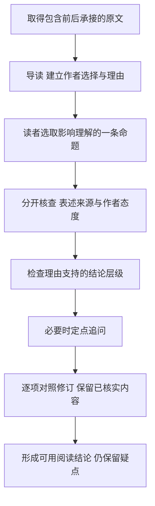
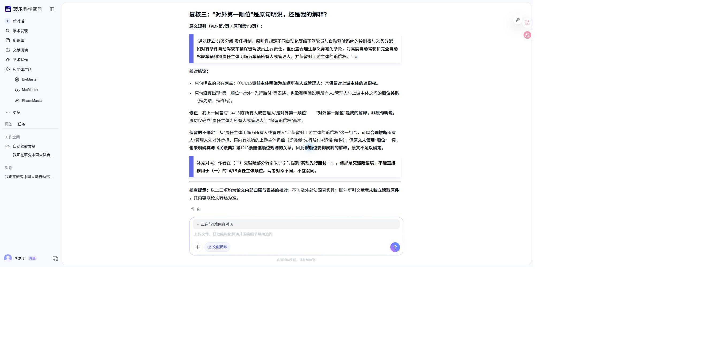

# AI读法学论文：把“观点来自谁”与“作者是否采用”分开

读法学论文时，AI能给出流畅的章节概括，却未必分清一句话是作者提出、转引他人，还是自己补出的解释。更细的回答也未必更可靠：一次定点纠错可能修正归属，同时撤回原文已经写出的内容。本文用刘宏宇《我国自动驾驶汽车保险制度的立法审视与完善进路》中的交强险和产品责任段落，演示如何让读者看清作者的选择、理由与边界，而不把判断交给AI代做。

## 一句话里可能有两层归属

原刊119页先呈现学者对车险市场冲击的预测，再转述更多学者肯定交强险适配性，并用“但他们强调”说明现有制度的适配问题。紧接着，作者用“有鉴于此”提出增设强制保险的修法建议。

“他们”指向被转引学者；“有鉴于此”又表明作者将这一问题用于自己的建议。因此，“表述来自他人”和“成为作者的理由”可以同时成立。只让AI在“作者观点/他人观点”中选一个，可能把采用误当原创，也可能反过来认为转引就与作者论证无关。

这里的目标不是评价某个保险方案是否正确，而是回答一个具体阅读问题：**论文如何从所引观点走到自己的制度选择，哪些联系是原文建立的，哪些只是AI解释？**

## 用七个字段表达一条可核查的命题

我的做法是在读到关键选择时，形成一条映射：命题、表述来源、作者态度、论证功能、条件、位置、核查状态。它是读者核对的视角，不要求模型为全文生成七列表，也不是已经自动实现的语义分类器。

|字段|本例怎样填|避免什么误读|
|---|---|---|
|命题|现有交强险难完全适配自动驾驶|只列“存废争议”却不解释选择|
|表述来源|“更多学者”及“但他们强调”承接的转述|把被引观点写成作者独立提出|
|作者态度|后文“有鉴于此”将该问题用于修法建议|以为转引就没有被作者采用|
|论证功能|提供制度改造的理由|把理由存在当作效果已实证|
|条件|原文列明保障对象及自动驾驶情形|为简短省掉对象与适用范围|
|位置|PDF原页8、刊119，随包A1/A2|把网页按钮号当原刊脚注|
|核查状态|文内归属可核；引文原件未独立读取|把内部引注当外部真实性核验|

处理次序是先确定最小的完整上下文，再检查承接词和注码，最后判断作者采用了什么。先行词不明确时，扩大到前一句；论证关系不明确时，看到建议句；超过本次材料范围时停止，不把缺口猜成答案。

## 材料怎样准备，程序做了什么

原论文载《东南大学学报（哲学社会科学版）》2026年第3期112—122页。随包A是PDF8/刊119中连续的交强险讨论和同页脚注，完整包含作者提高限额、增设系统故障专项限额的建议。B是PDF7—8/刊118—119的风险二分与OTA段落，跨页句接续保留。C只补充平台复核需要的分级责任原句。均由用户PDF提取，仅删除排版空白，并核对原页；它们不是整篇论文。

上版片段在学者争议介绍处结束，模型据此不判断作者全文最终立场是合理边界控制。这一版增加相关建议句，是为了让当前阅读问题能在材料内闭合；不能用不同范围的答案直接证明模型进步。

本地入口先检查源文SHA256，建立新目录，将冻结Skill阅读要求和完整转录通过标准输入交给模型，模型不执行命令，程序保存回答、实际prompt、原生事件和运行记录。已有目录会拒绝覆盖。此处转录已经准备好，不是让模型重新运行PDF脚本，也不声称在其他平台安装了完整Skill。

本文直接提供完整片段转录，使两臂取材一致，避免把工具读取能力与语义归属能力混在同一变量里。冻结Skill的辅助脚本仍随包，但本次没有让模型运行它们。

## 先做一个不容易“赢”的对照

两臂都使用同一冻结Skill、同一源文、同一自然阅读需求和gpt-6-luna/MAX。方法臂仅增加一份通用“声音—命题—支持—边界”协议，没有给本篇答案或核查标准。A按基线/方法运行，B反向运行；四次调用前写定标准，均完成且输入指纹未变。材料在此前已经读过，属于开发案例，复核也非盲。

|案例|两臂共同完成的内容|没有解决的问题或观察|
|---|---|---|
|A：交强险选择|交代市场预测与适配观点、作者具体修法建议、限额理由和引注范围|两臂仍以“作者指出”概括“他们强调”承接的适配问题，没有充分分开表述来源与作者采用|
|B：风险与严格责任|保留运行/产品风险、缺陷推定与无过错免责原句、OTA时点，均识别严格责任与免责的张力|新增协议没有显示明显语义优势；不能把基线已经做到的内容归为新方法贡献|

完整输入输出与逐项核查见[本轮记录](../evidence/本轮对照核查.md)。A耗时70.781/54.032秒，B为36.860/45.532秒，方向不一致；没有提速结论。累计输入、缓存及输出见原始摘要，不能把累计token当单次提示词长度，也没有可得的货币费用。两段、各一对不足以证明稳定性或普遍性。

据此，我没有把新增协议默认堆进每次生成。它保留为可选提示词和读者核查单；实际流程优先给完整上下文、生成导读，再核查影响判断的关系。否定“多一段提示词就必然更好”，本身就是这次实践的结果。

## 在玻尔完成一次有修复、也有反例的实践

进入玻尔“文献阅读”，上传同篇PDF，先建立整体导读。本例沿用已有会话，前两轮上下文、输入和实际输出都随包保留；本轮第三答采用上述通用检查方向，第四答只追问三处实际疑点。因此这是带上下文的定点复核，不是无提示独立试验。平台模型、费用与内部轨迹未显示。

第三答能介绍制度选择、脚注来源性质，也把严格责任与无过错免责的可能解释标成自己的理解，但仍存在三类问题：以“自己的理由”叙述转引内容；把市场萎缩预测称为“否定说”；把所有人/管理人责任与追偿扩展为明确“对外第一顺位”。标签齐全不等于关系正确。

我没有要求“重新写得更严谨”，而是让它回到具体原句核对：谁是“他们”的先行词？市场预测是否足以推出废除主张？顺位是原句明说还是解释？[第四答](../results/bohrium/定点复核回答-可见原文.txt)纠正了转引承接，也将第一顺位降为自身解释。这是实际修复，而不是用我写的正确答案替换模型输出。

但它同时把“是否有必要”也说成推断性概括。回查A1可见原文确有“‘交强险’制度是否还有必要，学界尚存争议”。应撤回的是“被引学者明确主张废除”的过强归纳，不应撤回论文提出了必要性问题这一事实。它还在自身解释里增加“有过错的上游主体”，原分级责任句未写这一限定，不能直接带入作者方案。

第四答又说相关转引“不是作者自己的理由”，随后承认作者以“有鉴于此”采用它。更精确的阅读结论应分两轴：**表述由被引学者提出，作者将其用于自己的建议；这不等于作者独立提出，也不意味着它与作者的理由无关。**这一步是本人对原文和两次回答的复核，不声称模型已自动解决。

截图用于说明操作完成；全部关键文字另有完整转录，不靠图片传递证据。平台引用编号与原刊脚注分别识别；未独立核实每个引用按钮的展开行为。

## 用机械检查守住修订边界

仓库的find_quote.py只做NFKC和空白归一后的原文匹配，返回命中段落及上下文，不做同义改写，也不输出语义得分。比如检查A中的“制度是否还有必要”确实命中；“废除交强险”未命中。B中“除非其能证明自己不存在过错”命中，换成“证明产品不存在缺陷”不命中。

这能提醒读者：不要为了化解严格责任与免责的张力而偷偷替换原句，也不要在修正“否定说”时删除原本存在的设问。不过，匹配不能判断“他们”承接谁，也不能证明论文方案可行；未命中只说明当前片段没有该串文字，不能宣布全文或所引文献没有该观点。八项实际运行结果和方法边界均随包。

## 读者最终怎样用这套方法

先用导读判断论文是否相关，再选择一条真正影响研究判断的命题。核对它的表述来源、作者态度及支持关系，发现具体疑点才追问。收到纠正后，逐项核对修改及新增限定，保留原来已经正确的信息；不因模型承认错误就全盘接受新答案。

本例最后可采用的阅读结论是：作者从市场冲击预测与适配观点的对照出发，采用制度适配问题作为强制保险改造的理由，进一步提出限额与故障风险安排；段内引注说明其援引关系，不能单凭引注确认效果已被实证。产品责任段落提出风险二分、严格责任和举证缓和，也留下无过错免责如何衔接的张力，读者应保留原句而非替其补成完整规则。

可迁移的是核查动作，而不是本文的答案。其他文献需要重新识别承接、对象和证据；复杂图表、扫描文本及外部法源真实性也需要额外核查。这份分享展示了真实成功、未改善与过度纠正，使读者能在AI辅助下保留自己的判断。
